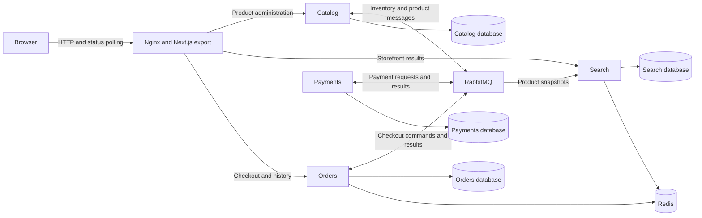

# Fieldwork Market architecture

## Why these boundaries

The design separates workloads with different correctness and latency needs. Browsing can use a slightly stale snapshot. Stock reservation must use current quantities and prices under a transaction. Orders needs a durable record of a purchase as it progresses. Payment processing has its own lifecycle and failure modes. Each service owns the decisions and data for one of those workloads.

- **Catalog** owns products, current prices, stock, CSV intake, and inventory reservations. Keeping product and inventory writes together lets Catalog check a quote and reserve every line in one PostgreSQL transaction.
- **Search** owns the browsing projection and query cache. A storefront search reads its own database and never joins the stock reservation transaction. If Catalog goes offline, Search can serve snapshots it has already applied. Pending updates become visible when it catches up.
- **Orders** owns checkout, history, and the order state machine. It records a pending order and coordinates inventory and payment through messages. The browser can then read progress independently of the original request.
- **Payments** owns the recorded simulator decision. Its separate worker and queue keep payment processing out of product administration and browsing. The separate payment page uses the same local HTTP gateway.

These boundaries make separate resource allocation possible. For example, a browse-heavy workload can tune its Search queries and cache without changing the stock checks in Catalog. RabbitMQ lets publishers and consumers work at different rates. A consumer has a prefetch limit of one delivery per instance in this setup. The queue absorbs bursts and grows if incoming work consistently exceeds processing capacity. Queue lag, database capacity, and contention still need measurement before increasing replicas. A modular monolith would cost less to deploy and operate for a single local store. This project uses services to demonstrate ownership, backlog recovery, and the checkout coordination required when these capabilities run separately.

Each service has its own PostgreSQL database and role. The local Compose stack hosts those databases on one PostgreSQL server and uses one RabbitMQ node. It also runs one instance of each application service and one Nginx gateway. The deployment therefore demonstrates isolation from some service outages and recovery after interruptions. PostgreSQL, RabbitMQ, and the gateway remain single points of failure. [Compose topology](../compose.yaml) · [Database ownership](../infra/postgres.sql) · [Consumer configuration](../backend/internal/platform/broker.go)

## How the system communicates

The browser uses synchronous HTTP for reads, product administration, and accepting buyer actions. Nginx serves the static Next.js pages and proxies `/api/catalog/`, `/api/search/`, and `/api/orders`. The browser reads order progress by polling. The Go services communicate asynchronously through a RabbitMQ direct exchange named `ecommerce.events`, with a durable queue per subscribing service.

The system is **event-driven between services**. Commands such as `inventory.reserve.v1` ask a specific service to act. Events such as `inventory.reserved.v1`, `payment.declined.v1`, and `product.changed.v1` report an outcome or a state change. Orders chooses the next command from its current state and incoming result, so the checkout is an **orchestrated saga**. Search updates independently when it receives a product change. PostgreSQL stores the current business state, and the outbox holds messages awaiting publication. [HTTP routes](../infra/nginx.conf) · [Message contracts](../backend/internal/contract/contract.go) · [RabbitMQ bindings](../backend/internal/platform/broker.go) · [Saga orchestration](https://docs.aws.amazon.com/prescriptive-guidance/latest/cloud-design-patterns/saga-orchestration.html)

### Product writes and search

1. Catalog commits a product change and a `product.changed.v1` outbox record in the same transaction. Checkout-driven changes to available stock follow the same publishing path.
2. Search consumes the snapshot. An upsert applies a version newer than the one it already has. A deletion remains in the projection as a versioned tombstone so a late update cannot make a deleted product visible again.
3. An applied change advances the projection revision. Search includes that revision in its Redis query key. Old entries become ineligible for reads and expire. Search falls back to its PostgreSQL projection when Redis is unavailable.

A search result can briefly lag Catalog. Checkout still checks the current quote and stock in Catalog before asking Payments to decide. Search reads the latest projection revision from PostgreSQL even on a cache hit. [Catalog write path](../backend/internal/catalog/catalog.go) · [Search projection and cache](../backend/internal/search/search.go)

### Checkout and compensation

1. **Start checkout.** The browser sends `POST /api/orders` with an idempotency key. Orders stores `awaiting_payment` and returns `202 Accepted`. The row appears in order history. Stock remains available while the buyer decides or leaves the simulator.
2. **Submit a choice.** The separate simulator page posts an approval or decline choice to `POST /api/orders/{id}/payment`. Orders locks the row, records the first choice, changes the order to `pending_inventory`, and inserts `inventory.reserve.v1` in the same transaction. A repeat of the same choice returns success. A conflicting choice returns `409 Conflict`.
3. **Reserve inventory.** Catalog locks product rows in a stable order, checks availability and quoted prices, and reserves all items atomically if the checks pass. `inventory.rejected.v1` ends the order as rejected. `inventory.reserved.v1` gives Orders the confirmed total and line snapshots. Orders moves to `pending_payment` and sends `payment.requested.v1`.
4. **Resolve payment.** Payments stores one simulated decision per order. On `payment.approved.v1`, Orders marks the order `paid` and queues `inventory.commit.v1` to settle the hold. On `payment.declined.v1`, it enters `releasing_inventory` and asks Catalog to restore the stock. Only `inventory.released.v1` makes the decline final. This restoration is the compensating action.
5. **Display progress.** The bag, simulator and order history read persisted order state over HTTP. Order history shows a numeric reference. The internal UUID continues to identify the order across services.

[Order creation](../backend/internal/orders/orders.go) · [Payment submission](../backend/internal/orders/payment.go) · [Inventory](../backend/internal/catalog/inventory.go) · [Payment worker](../backend/internal/payments/payments.go) · [Order transitions](../backend/internal/orders/saga.go)

#### Payment boundary and guarantees

Fieldwork Pay is a separate checkout page on the same local gateway. The buyer's choice selects the simulation outcome. Orders records the first choice and returns `202 Accepted` for that request. The simulator reads the actual order state from Orders before displaying a final result. Payments processes a broker message only after Catalog supplies the authoritative amount in cents and a successful stock reservation. It stores one decision per order and commits the result event in the same transaction. This boundary models an independent payment lifecycle while meeting the challenge's simulated payment requirement. [Simulator page](../frontend/src/components/PaymentPage.tsx) · [Payment request](../backend/internal/orders/payment.go) · [Payment persistence](../backend/internal/payments/payments.go)

Closing the simulator before choosing leaves a resumable order and available stock. When two checkouts compete for the last unit, the first eligible reservation committed by Catalog holds it. A competing checkout can be rejected before Payments receives a request. A simulated approval sets Orders to `paid` while the confirmation of the inventory hold is queued. A simulated decline becomes final after Catalog restores the reservation. A hold can remain pending during a prolonged failure after reservation. The current recovery path uses retries and operator replay when a message reaches its dead-letter queue. Reservation expiry and reconciliation would need defined rules before handling real payment uncertainty. [Last-unit behavior](../README.md#who-gets-the-last-unit) · [Inventory settlement](../backend/internal/catalog/inventory.go) · [Order saga](../backend/internal/orders/saga.go)

### Delivery, duplicates and outages

The **transactional outbox** writes a business change and any resulting message in one PostgreSQL transaction. A separate worker publishes the message persistently with mandatory routing and waits for the RabbitMQ confirmation before deleting the outbox row. A crash between publish confirmation and deletion can cause a resend. The receiving service inserts the message ID into its **inbox** within the transaction that applies the business change. It acknowledges RabbitMQ after commit. On redelivery with the same ID, the inbox uniqueness check skips the handler and the consumer acknowledges the message. Order creation keys, reservation records, and the payment record provide business-level idempotency in addition to message-level deduplication. [Outbox relay and consumer](../backend/internal/platform/broker.go) · [Transactional outbox pattern](https://docs.aws.amazon.com/prescriptive-guidance/latest/cloud-design-patterns/transactional-outbox.html) · [RabbitMQ reliability guide](https://www.rabbitmq.com/docs/reliability)

During a broker interruption, the database can accept an order or payment choice, and the outbox retains work until publication resumes. During a Catalog outage, Search can still serve its last applied projection while stock-dependent checkout waits. A PostgreSQL outage can affect all four services in this deployment. Repeated processing failures can move a message to a dead-letter queue and leave the related order pending until an operator resolves the cause and replays it. The repository verification records recovery after a broker restart. Peak throughput and failover under production traffic remain unmeasured. [Recovery evidence](work-items/separate-payment/spec-overview.md) · [Operator procedure](../README.md#operations-and-verification)

## Development practices in the current code

### Maintainability

Local changes have clear starting points. Product rules and CSV handling live in Catalog. Search filters and caching live in Search. Checkout transitions live in Orders, and the simulated decision lives in Payments. The shared Platform package owns connection setup and message delivery. On the frontend, route pages compose UI components, `api.ts` owns HTTP calls and wire types, and `checkout.ts` owns bag and checkout state. This keeps most view and domain changes in their respective areas. [Catalog](../backend/internal/catalog/) · [Orders](../backend/internal/orders/) · [API client](../frontend/src/api.ts) · [Checkout state](../frontend/src/checkout.ts)

The main maintenance cost is following a change across boundaries. Search ranking has a clear entry point in Search's query code. A new payment result can affect the Payments worker, message payloads, Orders' state transition and storage constraints, and the TypeScript status and label. The shared Go module makes related contract edits easy to review together. Topic names are versioned. HTTP shapes are maintained separately in Go and TypeScript, and the frontend still relies on type assertions at runtime. The saga model and Docker smoke cover important cross-service behavior. For services released independently, compatibility checks for message and HTTP contracts would reduce rollout risk. [Search queries](../backend/internal/search/search.go) · [Message contracts](../backend/internal/contract/contract.go) · [Order storage](../backend/internal/orders/orders.go) · [Transitions](../backend/internal/orders/saga.go) · [Saga model](../backend/internal/orders/saga_model_test.go) · [Smoke suite](../scripts/smoke.py)

### Go backend

- **Bounded packages and explicit errors.** Service entry points live in `backend/cmd`. Business and infrastructure packages live in `backend/internal`. The transport and lifecycle code is shared in Platform. Handlers use standard `net/http`, request contexts, explicit errors and structured `slog` logging. Service startup and shutdown, HTTP reads and writes, database pool size, and message processing have explicit limits. [Service lifecycle](../backend/internal/platform/service.go) · [Go review guidance](https://go.dev/wiki/CodeReviewComments)
- **Validate at the boundary and enforce invariants in storage.** The HTTP decoder limits JSON bodies and rejects unknown fields. Catalog validates product limits and uses parameterized SQL. PostgreSQL constraints and transactions protect unique keys and inventory. Catalog uses row locks for reservations and a product version with `If-Match` to catch stale administrative updates. Prices use integer cents in Go rather than binary floating-point arithmetic. [HTTP input handling](../backend/internal/platform/http.go) · [Product validation](../backend/internal/catalog/catalog.go) · [Inventory transaction](../backend/internal/catalog/inventory.go) · [Money parsing](../backend/internal/contract/contract.go)
- **Test behavior with risk.** The Go tests cover CSV parsing, checkout normalization and invalid input. The order model exercises valid and out-of-order results by calling the production transition function. The Docker smoke exercises database, broker, API and gateway together, including repeated requests, concurrent purchases, and stock compensation. [Catalog tests](../backend/internal/catalog/import_test.go) · [Order tests](../backend/internal/orders/orders_test.go) · [Saga model](../backend/internal/orders/saga_model_test.go) · [Smoke suite](../scripts/smoke.py)
- **Improvement before a larger deployment.** Schema creation and updates currently live inside service startup. A versioned migration workflow would make rollout order and recovery explicit. Service logs and database health checks give a starting point for operations. Queue lag, outbox age, dead-letter alerts, and end-to-end correlation would make pending checkout failures easier to diagnose. The outbox currently publishes one row at a time while holding a database transaction. Measure that path and Search's substring queries before choosing scaling changes. [Startup schema handling](../backend/internal/platform/service.go) · [Outbox relay](../backend/internal/platform/broker.go) · [Search queries](../backend/internal/search/search.go)

### TypeScript frontend

- **Strict compilation and a common HTTP client.** TypeScript enables `strict`, `noUnusedLocals` and `noUnusedParameters`. The Next.js production build checks types. The centralized API client defines typed payloads, handles HTTP errors, and applies a request timeout. Search and order polling use abort signals and clear scheduled polling when the relevant view is removed. [Compiler configuration](../frontend/tsconfig.json) · [Build scripts](../frontend/package.json) · [API client](../frontend/src/api.ts) · [Polling cleanup](../frontend/src/checkout.ts) · [TypeScript strict reference](https://www.typescriptlang.org/tsconfig/#strict)
- **Explicit UI state and exact totals.** Order status is a string union with a status label for each member. The checkout hook retains the order creation key for retries and computes estimated totals using `bigint` cents. The UI displays the authoritative total as soon as it receives one from Orders. The bag uses the shared shadcn/ui dialog for focus, keyboard dismissal and accessible labels. [Order types](../frontend/src/api.ts) · [Checkout state](../frontend/src/checkout.ts) · [Dialog](../frontend/src/components/ui/dialog.tsx)
- **Cart recovery and HTTP response validation.** The cart loader validates stored lines and checkout attempts. It clears incompatible lines, keeps valid attempts for idempotent retries, and asks the buyer to check Orders if an attempted checkout cannot be restored. The HTTP client checks status and JSON parseability, then asserts a generic type with `result as T`. Runtime decoders would catch responses with incompatible shapes before rendering. The repository smoke covers HTTP. A maintained frontend lint and browser test command would help make frontend checks repeatable in CI. [Cart deserialization](../frontend/src/checkout.ts) · [API assertion](../frontend/src/api.ts) · [TypeScript type assertions](https://www.typescriptlang.org/docs/handbook/2/everyday-types.html#type-assertions)

## Challenge scope and production readiness

The [production readiness review](production-readiness.md) lists current risks and commerce capabilities outside the exercise.

The project covers the local challenge flow from CSV import and product administration through search and simulated purchase. The Docker smoke verifies the production-built frontend, fixture handling, concurrent purchases, idempotent requests and stock compensation. The operating guide provides the [local run and verification commands](../README.md#operations-and-verification).

For an enterprise production rollout, the current deployment would need concrete operating guarantees:

- **Access and payments.** Add customer identity, order ownership and catalog administration roles before exposing the gateway. A real provider needs authenticated result handling and reconciliation of uncertain outcomes, with an inventory release policy that accounts for payments still in progress.
- **Availability and recovery.** The local stack has one PostgreSQL server, one RabbitMQ node and one gateway. A production design needs redundancy, backups and tested restore and failover. Quorum queue configuration on the current single broker gives no second node to take over. [RabbitMQ production deployment guidance](https://www.rabbitmq.com/docs/production-checklist)
- **Operating evidence.** Define latency, throughput and recovery targets. Measure them under load and interruption. Monitor pending orders, the oldest outbox row, queue lag and dead-letter counts so incomplete purchases surface before users report them. [Reliability testing guidance](https://docs.aws.amazon.com/wellarchitected/latest/framework/rel12.html)
