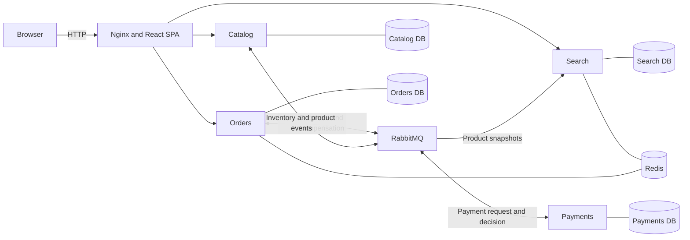

# Design

This design records the original implementation. The [Next.js and separate payment design](../separate-payment/design.md) defines the current frontend and checkout API.

## Ownership and public API

The React storefront and management screens use the same origin. Nginx serves the static SPA and routes browser HTTP to the owning service.

| Service | Owns | HTTP |
| --- | --- | --- |
| Catalog | Active products, available stock, reservations | `GET/POST /api/catalog/products`, `GET/PUT/DELETE /api/catalog/products/{id}`, `POST /api/catalog/import` |
| Search | Versioned product projection and query cache | `GET /api/search/products?q=&category=&page=&limit=` |
| Orders | Checkout state and idempotency keys | `POST /api/orders`, `GET /api/orders/{id}` |
| Payments | Simulated payment decision and charged amount | Internal health endpoint |

Product JSON uses `id`, `version`, the seven CSV field names, and decimal strings for `price` and `weight_kg`. Product pages return `items`, `total`, `page`, and `limit`. Search adds `categories` for the filter. Updates and deletes send the observed version using `If-Match`. The CSV endpoint accepts a raw CSV request body and returns `imported`, `skipped`, and `issues` with `line`, `sku`, and `message`.

Checkout accepts `items` with `product_id`, `quantity`, and `unit_price`, plus `payment_outcome` as `approve` or `decline`. Require a random UUID in `Idempotency-Key`. A successful creation or equivalent replay returns HTTP 202 and `id`. Status reads return `id`, `status`, optional `reason` and `total`, and item snapshots. Error responses use `error` as a human-readable message. Requests cap bodies and reject unknown fields.

## Message flow

1. Orders creates a `pending_inventory` order and queues `inventory.reserve.v1` in its outbox.
2. Catalog locks requested products in stable UUID order. It validates available quantity and quoted price across all items. It writes the reservation, available stock and `product.changed.v1` snapshots in one transaction before replying with `inventory.reserved.v1` or `inventory.rejected.v1`.
3. Orders accepts a successful reservation, stores catalog snapshots and total, moves to `pending_payment`, and sends `payment.requested.v1`.
4. Payments stores one decision per order and emits `payment.approved.v1` or `payment.declined.v1`. Approval changes the order to `paid` and sends `inventory.commit.v1`. Decline changes it to `releasing_inventory` and sends `inventory.release.v1`. The catalog restores stock and sends `inventory.released.v1` before the order becomes `rejected`.
5. Search projects `product.changed.v1` by product version, including tombstones. A projection-wide revision advances in the same transaction when newer data is applied. Cache keys include the projection epoch and revision. Results expire after 90 seconds of inactivity.

Each service has a private PostgreSQL database and credentials on one local server. A message UUID identifies every delivery. The consumer commits inbox deduplication, business state and new outbox entries in one database transaction. The publisher deletes an outbox row after a broker confirm and a routing check. A crash between confirm and deletion can resend the message safely. Durable queues retain events during dependency outages. Consumers wait for a database that becomes unavailable and retry failed processing after it responds. Repeated processing failures enter a dead-letter queue for investigation and replay. Redis caches checkout key-to-order mappings for 24 hours. Orders checks cached mappings against its persisted key and request fingerprint.

## Alternatives

- A modular monolith would reduce operational complexity and suit a limited deployment. Four separately runnable services meet the requested service boundaries and let the storefront read through Search during Catalog or broker downtime.
- A synchronous checkout chain would return fast under ideal conditions and couple every request to downstream availability. Asynchronous commands leave durable pending orders during outages. An orchestrated saga gives Orders explicit ownership of status and compensation.
- PostgreSQL provides relational constraints, row locks and atomic outbox writes. SQLite would simplify a single process and introduce a shared-writer deployment constraint. A document store could support transactions and would add a different consistency and data model for little benefit here. [PostgreSQL row locks](https://www.postgresql.org/docs/current/explicit-locking.html#LOCKING-ROWS)
- RabbitMQ provides direct routing, acknowledgments and persistent queues for the command and event flow. Kafka is a good fit for retained logs, broad replay and independently managed offsets. This local topology prioritizes the smaller operational footprint of RabbitMQ. [RabbitMQ acknowledgments and confirms](https://www.rabbitmq.com/docs/confirms)
- Redis is disposable and shares hot query and checkout lookup entries across instances. Search reads and extends the cache lifetime in one `GETEX` call on a hit. An in-process cache would duplicate entries and lose them on restart. PostgreSQL remains the durable authority for checkout and stock. [Redis GETEX](https://redis.io/docs/latest/commands/getex/)
- Go supports these concurrent network services with compiled binaries, standard HTTP and focused SQL and AMQP clients. Java/Spring offers mature messaging and transaction integration with a larger runtime and framework surface. PHP and a worker framework are viable with additional process conventions for these continuous consumers.
- React with Vite and shadcn/ui serves a static SPA. All screens use live APIs. Next.js supports SPA and static export and becomes useful if public indexable product pages or server-rendered routes enter scope. [shadcn/ui for Vite](https://ui.shadcn.com/docs/installation/vite), [Next.js SPA guide](https://nextjs.org/docs/app/guides/single-page-applications)
- PostgreSQL powers the small search read model. A dedicated search engine would add relevance features and rebuild tooling at the cost of another distributed dependency.

Local Compose runs one instance of each data dependency. Independent processes and service-owned data provide isolation. Production high availability requires replication, backups, authentication and monitoring.

## Configured verification

The runtime skill wraps the real HTTP smoke checks and maps browser interactions to the same feature paths. A unique Compose project name isolates data and lets the verifier clean up its own services and volumes. Evidence stays in a temporary directory outside the project.

The formal skill explores reachable states through the order service's actual transition function. It covers duplicate and reordered delivery, checks irreversible outcomes and required commands, and prints a counterexample path on failure. Docker smoke checks complement the model with real inventory and payment transactions.
